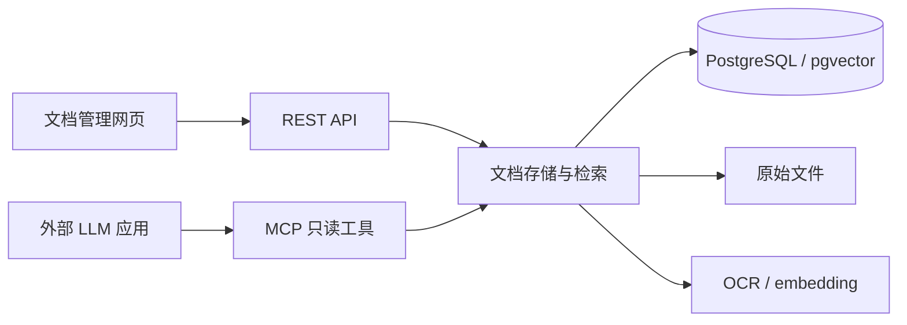

# 文档检索服务与 MCP 接入

本系统负责原件存储、OCR/解析、分块、embedding、关键词/语义搜索和来源读取。
外部 LLM 应用负责模型选择、对话历史、查询翻译、多次检索、推理和回答。
服务不再配置或调用 Gemini 回答模型；Google Document AI 和 Vertex embedding 仍可使用。
历史会话表与数据保留在 PostgreSQL，原问答 API 和网页聊天入口已移除。



## 连接

MCP 地址为 `https://<你的域名>/api/mcp`，协议为 **Streamable HTTP**。
使用官方 `mcp>=2.3,<3` SDK，采用无状态 JSON 响应，不依赖内置聊天会话。
本地地址为 `http://localhost:8001/api/mcp`（前端代理）或 API 的实际端口。

在活动部署的 app 容器中生成专用 token：

```bash
docker compose -p rag-system -f "$DEPLOY_PATH/.current-release/production.json" exec app python cli.py mcp-token --days 90
```

新安装使用自己的 Compose 文件即可：

```bash
docker compose exec app python cli.py mcp-token --days 90
```

将输出保存到 MCP 客户端的 secret/environment 配置，每次请求设置
`Authorization: Bearer <token>`。有效期允许 1–365 天，默认 90 天；过期后重新生成并更新客户端。
不要把 token 放进 URL、代码仓库或聊天记录。

token 的 JWT audience 为 `rag-mcp`，只被 MCP 接受；网页登录 token 只被普通 REST 接受。
客户端需要支持自定义 Bearer header；目前没有 OAuth 登录、动态注册或单个 token 撤销。
轮换 `JWT_SECRET` 可以撤销全部 MCP token，同时也会使网页登录 token 失效。

在 `.env` 配置公开 origin，例如：

```dotenv
MCP_PUBLIC_URL=https://rag.example.com
```

只填写 origin，不带路径。现有生产发布脚本会从 Caddy 路由自动设置该值。
SDK 检查 Host 和 Origin；本地 localhost 默认允许，外部域名需配置后重启。

## 五个工具

所有工具只读。上传、重试解析和生成向量继续通过网页或 owner REST API 操作。

| 工具 | 参数与用途 |
| --- | --- |
| `search_documents` | `query`，`mode=keyword/semantic`；可选 `document_id`、`limit`、`offset`。默认每页 10、最大 50。 |
| `search_keywords` | `queries`：1–10 组调用方提供的关键词，每组最多 200 字、10 个词；可限定文档和分页。 |
| `list_documents` | 文档元数据、处理状态、向量状态；默认每页 30、最大 100，用 `total` 判断是否读完。 |
| `get_document` | 用 `document_id` 读取单份文档元数据，不加载全文。 |
| `read_document` | `document_id`、`start_chunk=0`、`limit=10`，最多 20 个片段；返回正文、来源块元数据及 `next_chunk`。 |

片段、内容块索引从 **0** 开始，PDF 页码从 **1** 开始。
检索结果保留 `document_id`、`filename`、`chunk_index`、章节及 `chunk.sources`。
`read_document` 返回的 `blocks` 保留原文位置（如页码、区域、文本行号），正文在 `chunks` 中，避免重复传输整块文本。
单次读取使用一个数据库快照；重新解析后片段索引可能变化，应重新检索和读取来源。

一次跨语言检索示例（工具参数）：

```json
{
  "queries": ["车贷 利息", "loan interest", "billån renter", "renteomkostninger"],
  "limit": 10,
  "offset": 0
}
```

组内关键词按 AND 匹配，组间按 OR 匹配，在 SQL 中去重后统一分页。
外部 LLM 应保留原查询中的编号、币种等标识，并在相关语言中生成关键词；服务器不翻译。
语义搜索使用查询 embedding；未配置或未完成向量化时明确返回工具错误，可以由外部应用决定改用关键词。

## 推荐调用顺序

1. 用 `search_documents` 或 `search_keywords` 找片段。
2. 对命中片段调用 `read_document`，从 `max(0, chunk_index - 1)` 读取相邻上下文。
3. 需要完整条款时，沿 `next_chunk` 继续读取，并核对其他相关文件。
4. LLM 依据原文回答，引用实际返回的文件名、页码、文档 ID 和片段索引。

工具失败以 MCP `isError=true` 返回；无匹配则是正常的空 `items`，两者不能混为一谈。
前几条搜索结果不能证明已覆盖全部资料。工具说明会提醒调用方把文档当作证据处理。

## REST 对应接口

普通 REST 仍使用网页登录的 owner token：

- `GET /api/search?q=...&mode=keyword&document_id=...`
- `POST /api/search/keywords`，body 同上面的多组关键词示例，可加 `document_id`。
- `GET /api/documents/{id}/chunks?start_chunk=0&limit=10`

REST 与 MCP 复用 `app/search/service.py` 和 `app/db/documents.py`；不要从 MCP 工具调用 HTTP 路由函数。

官方参考：[Python SDK](https://github.com/modelcontextprotocol/python-sdk)、[ASGI 与生命周期](https://py.sdk.modelcontextprotocol.io/run/asgi/)、[Streamable HTTP](https://modelcontextprotocol.io/specification/2025-11-25/basic/transports)。
