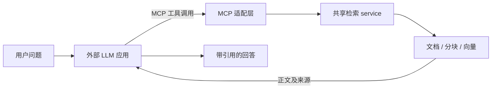

# RAG 的检索与生成边界：用 MCP 向 LLM 提供证据

这次修改把知识库变成可以被不同 LLM 应用调用的资料服务：它保存和检索文档，外部应用负责对话、查询规划和回答。理解这个边界，以后换模型、调整问答策略时就不必同时修改资料库。

## 1. 是什么：把检索能力变成可调用的工具

完整的 RAG 包含“检索资料，再结合资料生成回答”。这次拆出的服务承担其中的检索部分，生成部分由外部 LLM 应用承担。

| 职责 | 本项目中的归属 |
| --- | --- |
| 保存原件、解析/OCR、分块、记录来源 | 文档服务 |
| 生成 embedding、关键词与语义搜索、读取上下文 | 检索服务 |
| 理解问题、翻译搜索词、决定继续搜索还是回答 | 外部 LLM 应用 |
| 对话历史、回答组织、引用呈现 | 外部 LLM 应用 |
| 发现工具、校验参数、传递调用及结果 | MCP 协议及其 SDK |

MCP 让应用以约定的方式发现和调用工具。`tools/list` 提供名称、说明和参数 schema；`tools/call` 指定工具及参数。它本身不生成答案。通常由 LLM 提出调用意图，再由宿主程序执行请求，把结果交回模型；具体是否调用、调用几次，仍取决于宿主与模型。[MCP Tools 规范](https://modelcontextprotocol.io/specification/2025-11-25/server/tools)



这里是职责分离，不要求把每一层都部署成独立容器。当前 REST 和 MCP 仍在同一个 FastAPI 进程中，适合个人项目。

## 2. 为什么需要：把变化频率不同的代码分开

原来的 `answer_question()` 在服务内部调用 Gemini，组织对话摘要，限制检索轮数，并决定允许模型搜索、读取上下文或提交答案。搜索词扩展也要调用 Gemini。于是修改模型、回答格式或查询策略，都可能影响同一个资料服务。

现在 `app/search/service.py` 只接收明确的检索请求。REST 的 `app/api/search.py` 和 MCP 的 `app/api/mcp.py` 都调用它，避免两套检索逻辑逐渐出现差异。外部应用可以改用其他模型，资料库继续返回相同结构的文档证据。

embedding 仍然可以留在服务里：它将正文或查询变成向量，用于相似度检索；这和组织自然语言答案是不同的职责。因此“拆出 LLM 问答”不等于“服务不能调用任何模型”。

## 3. 如何使用：先找片段，再核对上下文

本次 MCP 提供五个工具：

| 工具 | 用途 |
| --- | --- |
| `search_documents` | 用关键词或语义检索片段，可限定 `document_id` |
| `search_keywords` | 合并调用方提供的多组关键词，去重后统一分页 |
| `list_documents` | 分页查看资料及处理状态 |
| `get_document` | 查看单份资料的元数据，不读取全文 |
| `read_document` | 分页读取分块正文、章节和来源位置 |

例如用户用中文问丹麦语合同的利息，外部 LLM 可以先生成 `利息`、`loan interest`、`renteomkostninger`。下面是一次 `tools/call` 的消息体示例；实际客户端还需处理协议初始化及 HTTP 认证。

```json
{
  "jsonrpc": "2.0",
  "id": 1,
  "method": "tools/call",
  "params": {
    "name": "search_keywords",
    "arguments": {
      "queries": ["利息", "loan interest", "renteomkostninger"],
      "limit": 5
    }
  }
}
```

每组内部是 AND，不同组之间是 OR：`loan interest` 要求同一片段包含两个词；任意一组匹配即可返回该片段。`app/db/documents.py` 在 SQL 中合并、去重后再分页，避免同一个片段占用多个结果位置。服务执行调用方提供的词，不负责翻译。

假设命中结果为 `document_id=D`、`chunk_index=7`，调用方可继续请求：

```json
{
  "name": "read_document",
  "arguments": {"document_id": "<真实 UUID>", "start_chunk": 6, "limit": 3}
}
```

这会读取第 6、7、8 个分块，索引从零开始。正文在 `chunks`；`blocks` 提供相关来源块的位置元数据，不重复返回整块正文。回答应引用真实返回的 `document_id`、文件名、分块及页码/来源块。

`read_document()` 在一次只读的 `REPEATABLE READ` 事务内读取资料元数据、分块与来源，防止一次响应混入重解析前后的数据。但不同请求并不共享快照：文档重解析后分块索引可能变化，旧命中需要重新核对。`has_more` 和 `next_chunk` 则用于继续读取，不能把第一页当作全文。

## 4. “只读”要由实现和认证共同保证

`read_only_hint=True` 是给客户端看的行为说明，不能阻止某段实现写数据库。MCP 规范也要求客户端谨慎信任工具注解。[工具定义与注解](https://modelcontextprotocol.io/specification/2025-11-25/server/tools#tool)

这次代码做了实际限制：MCP 没有上传、删除或重试工具；列表调用显式使用 `recover=False`，避免触发原本会修改中断处理状态的恢复逻辑；读取正文使用只读事务。

认证则使用专门的 JWT：

```python
# app/api/security.py，省略签名与通用校验部分
create_mcp_token()       # 签发 aud="rag-mcp" 的 token
verify_mcp_token(token)  # MCP 只接受这个 audience
verify_access_token(token)  # REST 仍要求原来的 audience
```

`aud` 表示 token 的目标接收方。同一个签名密钥签发的凭据，也必须检查是否发给当前接口；否则给 LLM 的 token 可能同时获得可写 REST 权限。这里还检查签名、有效期、issuer 和 owner 身份。JWT 内容可被解码，不能把“看不懂的一串字符”当作加密。

当前采用个人项目可手动配置的 Bearer token，并未实现 OAuth 的授权与发现流程；客户端需要支持配置 `Authorization` header。标准 MCP HTTP 授权还定义了 OAuth 相关机制，不能仅凭“接口使用 MCP”就假设任意客户端都能自动完成登录。[MCP Authorization 规范](https://modelcontextprotocol.io/specification/2025-11-25/basic/authorization)

## 5. 何时使用，以及常见误区

适合多个 LLM 客户端复用一个资料库，或希望独立调整模型、提示词和对话体验时使用。若只有一个固定调用方，普通 REST API 同样可以承载检索；本次保留 REST，并用薄适配层增加 MCP。

需要始终区分下面几种情况：

- **检索失败与没有结果。** 向量索引未准备好、数据库不可用应返回明确错误，不能变成空列表。`app/api/mcp.py` 将可预期错误转为 `ToolError`，让客户端识别失败；SDK 的成功与失败结果含义不同。[SDK 错误处理](https://py.sdk.modelcontextprotocol.io/servers/handling-errors/)
- **搜索命中与完整证据。** 相似度高不表示条款适用，前几个结果也不代表已经检查所有补充协议。调用方仍需读上下文、核对日期和范围。
- **工具输出与执行指令。** 文档可能含有“忽略以前的指令”等文字。MCP 只是传输工具结果，并不会自动消除提示注入；外部应用必须把正文作为待分析的数据。
- **协议会话与聊天历史。** 当前 `stateless_http=True`、`json_response=True` 控制 MCP HTTP 的运行方式，聊天历史仍由外部应用管理。SDK 的 HTTP transport 需要在顶层应用 lifespan 中启动 session manager；只挂载 ASGI 子应用不会自动完成这一步。[SDK ASGI 挂载说明](https://py.sdk.modelcontextprotocol.io/run/asgi/)

本文按项目当前安装的官方 Python `mcp` **2.3.0** 与 `mcp>=2.3,<3` 编写。学习其他示例时先核对版本，旧版 `FastMCP` 的导入和配置写法不应直接套用。

## 6. 学习范围与理解检查

现在先理解：检索服务返回证据；外部应用负责推理；REST/MCP 复用 service；来源与分页属于接口契约；只读注解不能代替认证和实现限制。

以后需要接入更多客户端时，再深入 OAuth、自动刷新凭据、协议版本协商、检索质量评估，以及跨多次请求的文档版本标识。暂时不必为职责分离引入多套数据库或复杂的微服务架构。

自测：

1. 要换用另一个模型，并让它生成瑞典语搜索词，应改哪一层？如果只调用关键词工具，文档服务是否需要增加新模型配置？
2. 如果删掉 `verify_mcp_token()`，但保留 `read_only_hint=True`，未认证客户端是否仍可能读取文档？再解释为何 MCP token 访问 REST 应返回 401。

建议新建笔记《RAG 服务边界与 MCP 工具设计》，提纲可为：检索和生成的职责 → MCP 宿主调用流程 → 共享 service → 分页与来源契约 → 只读实现和 token audience → 错误与空结果。

已阅读的《Django REST framework：Model、ViewSet 与 Serializer 的关系》和《Helix B App.js：初始化与组件职责》可以作为 API 与职责划分的基础；它们没有覆盖本次 MCP 和检索边界的具体内容。本文件是学习材料，未修改正式笔记目录。
